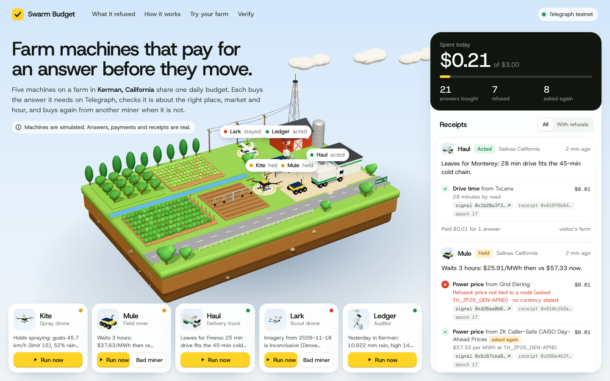
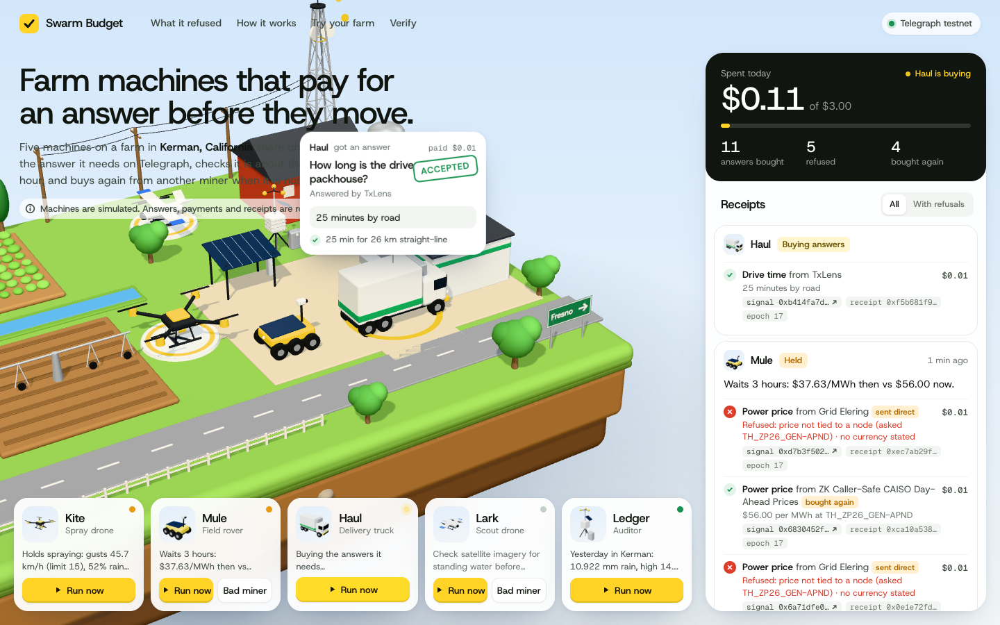

# Swarm Budget: farm machines that pay for an answer before they move, and refuse the wrong ones

**Live:** [swarmbudget.nerom.site](https://swarmbudget.nerom.site) · **Tutorial:** [pay, check and re-buy on Telegraph from Node](docs/TUTORIAL.md) · **Use the guard in your app or agent:** [`checked-ask`](packages/checked-ask/README.md) (library + MCP server) · **Video:** not recorded yet · **Built at:** Telegraph Hackathon Season II, Nov 2026 (Track 03 Apps & Agents; missions 11 Autonomous Systems and 06 Resources & Agriculture)

**Proof:** every answer the fleet uses is a paid Telegraph purchase. Its signal record on the public node names our wallet as the buyer, for example
[`/engine/v1/signal/0x2be2…99a8`](https://devnode.telegraphprotocol.com/engine/v1/signal/0x2be2cfc707ea4c40e67676a0b3366e0cf9f30dd8287f04a3d3a98df3597199a8),
paid from escrow by [`0x8482…A78E`](https://devnode.telegraphprotocol.com/v1/ledger/account/0x8482e592d6b28d3f5b713cc4576d6ce216b2a78e).





Five simulated machines work a real farm location in Kerman, California: a spray drone, a charging rover, a delivery truck, a
scout drone and an auditor. They share one daily budget, and each has its own share of it. Before any machine acts, it buys the answers it needs on Telegraph
(wind, storms, rain, power price, drive time, satellite imagery). A guard checks each answer is about the right place, market,
hour and unit. If an answer fails, the machine buys again from a different miner. A machine never acts on a refused answer.

## For judges: verify in 2 minutes
| Do this | You see |
|---|---|
| `npm install && npm test` | 50 tests. Guard tests run on real answers saved in `evidence/`, including the Kerman, Iran one. Failure tests (`test/failures.test.mjs`) replay saved answers through the real buyer, guard and fleet |
| `node tools/check-live.mjs` (against a running app) | PASS/FAIL for each claim below, read from the app and the public Telegraph node |
| Open the app and click **Run now** on Kite | The camera moves to Kite and a pulse leaves the telegraph mast. A card opens with the miner's answer, each guard check ticks in, then **Accepted** or **Refused**. The receipt lands on the right with a signal link to the node and the escrow receipt |
| Click **Bad miner** on Mule | First purchase goes to Grid Elering (Estonia) for a California node. The guard refuses it and re-buys from a CAISO miner |
| Click **Revoke pay** on Kite | Kite buys its storm alert (one real cent), then the owner's permission is withdrawn. The forecast is never bought and Kite stays put: "Stopped mid-task…" |
| Click **Unplug sensor** on Haul | Haul's reefer thermometer is offline. Haul holds the load and buys nothing ($0.00) |
| Scroll to **What an hour of work costs** | Cost per hour of machine work, per finished job, mean seconds to recover from a refused answer, and the spend on calls that did not act, overall and per machine, with what each machine has spent today of its own share |
| Scroll to **Did the forecast come true?** | Every forecast the fleet bought, scored once its day is over against the recorded weather Ledger bought for that day: rain calls right, Brier score, and the average miss on the day's high and low, by site and horizon (24 h and 6 h), with signal links to both answers |
| Type a farm in **Try your own farm** | Four machines decide for a new place on new, live answers |

## Mission 11 fit (Autonomous Systems, route 1 "Budget per machine")
The [mission 11 bounty](https://github.com/telegraphprotocol/bounties/issues/199) asks for simulated assets on a finite intelligence budget that buy route, weather and perception checks and report cost per operating hour. It names these tests and measures:

| Mission asks for | Here | Where |
|---|---|---|
| Cost per operating hour and per completed job | Every cent spent, divided by the hours of work it released and by the jobs done. Hours per job are simulated (Kite 1.5 h, Mule 1 h, Lark 3 h); Haul's are the real drive time there and back plus 20 min | `server/src/costs.mjs:28`, `server/src/fleet.mjs:26`, `:212` |
| Mean recovery time | Seconds from a refused or failed answer to the accepted re-buy that replaced it | `server/src/costs.mjs:8` |
| A finite budget allocated to distinct assets | One daily pool split by weight: Kite and Mule 25%, Lark 20%, Haul and Ledger 15% (`MACHINE_SHARES` overrides). A machine whose share is spent stops buying and says so; the others keep theirs. The budget meter shows one segment per machine | `server/src/budget.mjs:28-36`, `server/src/fleet.mjs:17-24`, `test/budget.test.mjs` |
| Unsafe action prevention | A machine acts only on accepted answers; refusals are counted and shown | `server/src/fleet.mjs:78-87` |
| Uncertain perception | Cloud-covered or empty satellite reads are inconclusive or refused, so Lark keeps the irrigation schedule | `server/src/fleet.mjs` `readImagery`, `test/fleet.test.mjs` |
| Disconnected sensor | A machine whose own sensor is offline holds and buys nothing, since no answer could make the job safe | `server/src/fleet.mjs:95-98`, test "disconnected sensor" |
| Revoked spend authorization | Checked before every purchase. Mid-task (simulated owner, real purchases) or the owner's standing switch (`POST /api/authority` with `OWNER_TOKEN`). Nothing is bought after the withdrawal and the machine does not act on half the evidence | `packages/checked-ask/checked-ask.mjs:75-79`, `server/src/buyer.mjs:14`, `server/src/fleet.mjs:82-85`, `:200-204`, `server/src/budget.mjs:30`, `server/src/server.mjs:29`, `:141-148`, tests "revoked spend authorization…" and "owner's standing revocation" |

## Mission 06 fit (Resources & Agriculture)
The [mission 06 bounty](https://github.com/telegraphprotocol/bounties/issues/194) is about agriculture and resource decisions that rely on paid intelligence. A farm that pays for forecasts should know whether they come true, so the fleet scores its own forecasts against the recorded weather, both bought on Telegraph:

| What it measures | How | Where |
|---|---|---|
| Rain call right or wrong | A forecast of 50% or more says "rain"; the day counts as rainy from 1 mm recorded | `server/src/forecast-check.mjs:33-63` |
| Rain score (Brier) | (forecast probability − what happened)², averaged; 0 is perfect, 0.25 a coin flip | `server/src/forecast-check.mjs:58` |
| Temperature error | Forecast high and low minus the recorded high and low, averaged as absolute misses (24-hour forecasts only) | `server/src/forecast-check.mjs:59-60` |
| By site and horizon | Grouped per farm and per forecast horizon: Ledger's 24-hour forecasts, and Kite's 6-hour pre-spray forecasts (rain only, scored against the whole day) | `server/src/forecast-check.mjs:89-104` |
| Records are bought, not assumed | Each run Ledger buys yesterday's record plus the oldest day a past forecast is still waiting on (up to 10 days back), then buys a fresh 24-hour forecast to be checked later. A record that is not published yet leaves the forecast waiting, and it is asked again on the next run | `server/src/fleet.mjs:170-183`, `server/src/forecast-check.mjs:66-69` |

Tests: `test/forecast-check.test.mjs` (8 tests, including Ledger run through the real buyer and guard on saved answers). Served in `/api/state` as `forecasts` (`server/src/server.mjs:113`); check-live: "forecast scores match the answers they were built from".

## Judging criteria
The rubric from the Telegraph H2 rules, one row per criterion with where we meet it, is in [JUDGES.md](JUDGES.md#rubric-telegraph-h2-rules). The submission itself (summary, the five commercial answers, run steps, evidence) is in [SUBMISSION.md](SUBMISSION.md).

## What the guard caught on the live network
| Asked | Miner answered | Guard |
|---|---|---|
| Storm alert for Kerman, California | `"Kerman, Kerman, Iran"`, gusts 21 km/h (TxLens, PREFLIGHT) | refused: same town name, different place. By coordinates, the real farm had **45.7 km/h**. See `evidence/name-vs-coordinates-STORM_ALERT.json` |
| CAISO price at `TH_ZP26_GEN-APND` | Grid Elering answer with no node and no currency | refused, then bought again: CAISO NP15 failed (500), ZK CAISO accepted at $57.33/MWh. See `evidence/rebuy-GRID_POWER_PRICE_GENERAL-714106.json` |
| Satellite read of the farm | an answer about Illinois / "no image supplied" | refused: wrong place, or no imagery was analysed. See `evidence/rebuy-SATELLITE_IMAGERY_ANALYSIS_GENERAL-7445.json` |
| Satellite read of the farm | PREFLIGHT: "Image fetched; the vision model was unavailable", with no reading | refused: an answer with no reading is not imagery analysis. Before this check, Lark irrigated on it. See `evidence/junk-SATELLITE-no-reading.json` |
| Satellite read under cloud | "dense cloud cover… impossible to observe the fields" | counted as **inconclusive**, so irrigation keeps its schedule. See `test/fleet.test.mjs` |

## Claims (every one checkable today)
| Claim | Where in code | Check |
|---|---|---|
| Pays Telegraph per answer with an EIP-191 signed escrow authorization in `X-PAYMENT` | `packages/checked-ask/escrow.mjs:55` (`askEscrow`), `:85`, `:91` | check-live: "every purchase carries a Telegraph signal hash and an escrow receipt" |
| Keeps the escrow receipt (`X-PAYMENT-RESPONSE`) for every purchase | `packages/checked-ask/escrow.mjs:100`, `server/src/store.mjs:21` | each receipt row shows `receipt …` and `epoch …` |
| Judges every answer before use | `packages/checked-ask/checked-ask.mjs:84`, `packages/checked-ask/guard.mjs:137` | `npm test` |
| Refuses a same-name town in another region or country | `packages/checked-ask/guard.mjs:41-49` | test "same town name in another country is refused" |
| Refuses a satellite answer that holds no reading | `packages/checked-ask/guard.mjs:113-114` | test "a satellite answer with no reading is refused" |
| Re-buys from the next compatible miner, ranked by our own pass rate per miner | `packages/checked-ask/checked-ask.mjs:45-60`, `:102` | check-live: "guard has refused… and a re-buy followed" |
| The guard and re-buy loop are a separate package, [`checked-ask`](packages/checked-ask/README.md), usable as a library or an MCP server for AI agents. The fleet runs on it | `packages/checked-ask/`; imported by `server/src/buyer.mjs:3` and `server/src/telegraph.mjs:5` | `test/checked-ask.test.mjs`; a live MCP run with two paid, accepted purchases: `evidence/checked-ask-mcp-live-2026-11-21.txt` |
| The MCP server's spending limits (per payment, per call, per session) are enforced in code before each payment | `packages/checked-ask/mcp.mjs:28-34`, `packages/checked-ask/escrow.mjs:70` | test "MCP: the per-call limit is enforced in code before paying" |
| Never acts on a refused answer | `server/src/fleet.mjs:78-87` (`get()` returns only accepted results) | check-live: "no machine acted on a refused answer" |
| Buys on its own schedule: one machine in turn every `TICK_SECONDS` (6 h live), no visitor involved. The schedule is read from saved decisions, so a redeploy does not reset it | `server/src/autopilot.mjs`, `server/src/server.mjs:52-69` | `test/autopilot.test.mjs`; check-live: "the fleet buys on its own schedule"; `/api/state` → `autopilot` shows the next machine and time |
| One shared daily budget, split into a share per machine; a machine stops buying when its share or the day is spent, and the others keep theirs | `server/src/budget.mjs:28-36`, `packages/checked-ask/checked-ask.mjs:75-79` (wired in `server/src/buyer.mjs:14`), shares in `server/src/fleet.mjs:17-24` | `test/budget.test.mjs`; check-live: "daily budget is enforced", "no machine spent past its share" |
| Withdrawn spending permission stops the very next purchase | `packages/checked-ask/checked-ask.mjs:75-79`, `server/src/buyer.mjs:14`, `server/src/fleet.mjs:82-85` | test "revoked spend authorization mid-task…"; check-live: "revoked-pay runs bought nothing after the withdrawal" |
| A machine with an offline sensor buys nothing | `server/src/fleet.mjs:95-98` | test "disconnected sensor…"; check-live: "unplugged-sensor runs spent nothing" |
| Reports cost per operating hour, per completed job and mean recovery time | `server/src/costs.mjs:8`, `:28`; served in `/api/state` as `costs` (`server/src/server.mjs:112`) | test "a completed Haul job records the round trip…"; check-live: "cost report matches the decisions" |
| Scores every bought forecast against the recorded weather for its day, by site and horizon | `server/src/forecast-check.mjs`, `server/src/fleet.mjs:170-183` | `test/forecast-check.test.mjs`; check-live: "forecast scores match the answers they were built from" |
| Weather asks use coordinates, because names resolved to the wrong country | `server/src/fleet.mjs:100-101` | `evidence/name-vs-coordinates-STORM_ALERT.json` |
| Satellite read passes real NASA GIBS imagery of the farm to the miner | `server/src/fleet.mjs:151-155` | the "Satellite read" question carries `image_url=` |
| The page animates a purchase only when one happened: the pulse starts on the server's `asking` event and lands on its `purchase` event | `server/src/server.mjs:35-36`, `web/app.js:480-482` | watch the network tab: one `/api/stream` event per pulse |

## Not built yet
- `checked-ask` on npm. It installs from GitHub today (`npx -y github:neromtoobad/swarm-budget` starts the MCP server).
- Real hardware. The machines are simulated: positions and motion in the 3D view are animation only. Motion follows real outcomes (Kite sprays only after an accepted "act", Haul leaves only when the drive fits), but nothing physical moves.
- x402 "exact" rail in production. The client supports it (`server/src/telegraph.mjs`, `ask()`), but the public facilitator timed out on settle during the event, so the app pays through escrow.
- Demo video.
- Real operating hours. Hours per job are a fixed table per machine (Haul's use the real drive time), since nothing physical runs.
- Real sensors. "Unplug sensor" simulates the sensor going offline; the rule it exercises (no sensor, no purchase, no move) is real code.

## What's real
| Part | Status | Proof |
|---|---|---|
| Telegraph purchases | real, testnet node, escrow rail | signal links in the ledger; `tools/check-live.mjs` |
| Payment | 5 test USDC deposited to the escrow Diamond `0x72a7…a08b` on Ethereum Sepolia | [ledger account](https://devnode.telegraphprotocol.com/v1/ledger/account/0x8482e592d6b28d3f5b713cc4576d6ce216b2a78e) |
| Guard, re-buy, budget, decisions | real code on every purchase | `packages/checked-ask/guard.mjs`, `packages/checked-ask/checked-ask.mjs`, `server/src/fleet.mjs` |
| Farm location geocoding | Open-Meteo geocoding, used only to set up a typed farm. It never feeds a decision | `server/src/fleet.mjs:42-61` |
| Cost per hour of work | real spend; **simulated** hours per job (Haul: real drive time) | `server/src/costs.mjs`, `MACHINES` in `server/src/fleet.mjs` |
| Revoke pay, Unplug sensor | the owner and the sensor are **simulated**; the purchases, the blocking and the hold are real | `server/src/server.mjs:82-91` |
| Machines, 3D farm | **simulated**: there are no drones. The UI and this README say so | `web/index.html` ("Machines are simulated…") |

## The problem
An autonomous machine that buys data has no way to tell a good answer from a confident one about the wrong place. On the
live network we saw a storm answer for Kerman, Iran instead of Kerman, California, an Estonian grid price for a California
node, and a satellite answer about Illinois. A spray drone acting on the first one would have used the wrong wind data.

## The page
- **The farm** is a 3D model (three.js) of the Kerman plot: orchard, lettuce, vines, a pivot irrigator, barn, cold store,
  charging canopy and a telegraph mast. The five machines sit on it.
- **A purchase is a pulse** on the wire between the mast and the machine. It starts when the server begins an ask and lands
  when the answer comes back. No purchase, no pulse.
- **The inspection card** opens over the machine: the question in plain words, who answered, what they said, each guard
  check, then a stamp: Accepted, Refused or No answer.
- **Receipts** (right) show today's spend against the budget and each decision's purchases, with signal and escrow links.
- **Below the fold:** what the guard refused, every miner's record, what an hour of work costs (overall and per machine), three failure tests you can run, whether the forecasts came true, one real decision as the four-step example, "Try your
  own farm", and the escrow account numbers read from the node.

## How it works
1. A machine starts a decision (`server/src/fleet.mjs`, `decide()`), on its own loop or from a visitor.
2. For each answer it needs, the buyer asks Telegraph, which routes to its top-ranked miner, and pays from escrow (`packages/checked-ask/escrow.mjs`).
3. The guard checks the answer against what was asked: place (by coordinates or by name with region/country), node, currency, hour, plausible ranges, and whether imagery was really analysed (`packages/checked-ask/guard.mjs`).
4. If it fails, the buyer picks the next compatible miner from `/engine/v1/intents/{intent}/miners`, skipping miners that keep failing, and buys again (`packages/checked-ask/checked-ask.mjs`).
5. Before every purchase the buyer checks the spending permission (the owner's switch and the decision's own mandate), the day's budget and the machine's own share of it (`server/src/budget.mjs`). A machine whose own sensor is offline buys nothing.
6. Ledger, once a day, buys the recorded weather for days that past forecasts covered and scores them (`server/src/forecast-check.mjs`).
7. The machine acts or holds only on accepted answers. Every purchase, verdict, receipt and signal hash goes to SQLite (`server/src/store.mjs`) and streams to the page over SSE (`server/src/server.mjs`). Each completed job records its hours of work, which `server/src/costs.mjs` turns into cost per hour and per job.

## Telegraph integration
- **Intents used:** `STORM_ALERT_GENERAL`, `WEATHER_FORECAST_GENERAL`, `GRID_POWER_PRICE_GENERAL`, `ROUTE_ETA_GENERAL`,
  `SATELLITE_IMAGERY_ANALYSIS_GENERAL`, `WEATHER_FORECAST_VERIFY_GENERAL`, `TASK_EXECUTION_QUALITY_GENERAL`.
- **Routed and direct asks:** `POST /engine/v1/ask` for the first try, `POST /engine/v1/ask/{minerId}` for re-buys.
- **Miner discovery:** `/engine/v1/intents/{intent}/miners` (compatible miners) feeds the re-buy ranking.
- **Payments:** escrow scheme: challenge from the 402, EIP-191 signature, receipt from `X-PAYMENT-RESPONSE`, billed at epoch close.
- **Proof:** `/engine/v1/signal/{hash}` for each answer, `/v1/ledger/account/{addr}` for spend.

## Trust model & limitations
- One server-held testnet key pays for everything (`EVM_PRIVATE_KEY`). Visitors never sign anything. Their paid actions are rate-limited (8 decisions and 3 farm runs per IP per hour) and capped by the daily budget.
- The live site runs on **$0.30 a day** and decides on its own every 6 hours, because the escrow holds about 4.4 test USDC and has to last through judging. At $0.30 a day the shares are $0.075 (Kite, Mule), $0.06 (Lark) and $0.045 (Haul, Ledger): four to seven answers each. When a share or the day is spent, machines hold and say so, and purchases resume at 00:00 UTC. Locally the default is $3 a day.
- The guard checks consistency with the question. It cannot prove a gust reading is true. The auditor machine (Ledger) later checks yesterday's spray call against recorded weather.
- The **Bad miner** button points the first purchase at miners we saw fail before (`server/src/server.mjs:86`). The refusal itself still comes from the guard on the live answer.
- **Revoke pay** simulates the owner withdrawing permission after the first paid answer. The real owner's switch is `POST /api/authority {"revoked": true}` with `Authorization: Bearer $OWNER_TOKEN`; with no `OWNER_TOKEN` set, the switch is off. It persists in SQLite until switched back.

## Run it
```bash
npm install
npm test                        # no key, no network, no spend
cp .env.example .env            # add a fresh testnet key (it needs ~0.01 Sepolia ETH for gas)
npm run fund -- --deposit 2     # mint test USDC, then approve + depositUSDC 2 into the Telegraph escrow (--dry-run to simulate)
npm run dev                     # http://localhost:4380  (TICK_SECONDS=0 to stop the automatic loop)
node tools/check-live.mjs       # in another shell
```

## Built at the event
First commit 2026-11-19, after the event start (2026-11-01). Nothing was reused from earlier projects. Work was committed in batches at checkpoints, so several commits share a timestamp. The largest commit (`797fb0d`) is raw probe answers saved as evidence JSON, not code. Libraries:
`@x402/fetch`, `@x402/evm`, `viem`, `three` (CDN). `RESEARCH.md` and `PLAN.md` hold the notes made while choosing the idea.

## AI usage
Built with Claude Code: research on the Telegraph API, code, tests and this README. Each decision and refusal shown in
the app comes from live Telegraph answers at run time. Nothing is canned.
